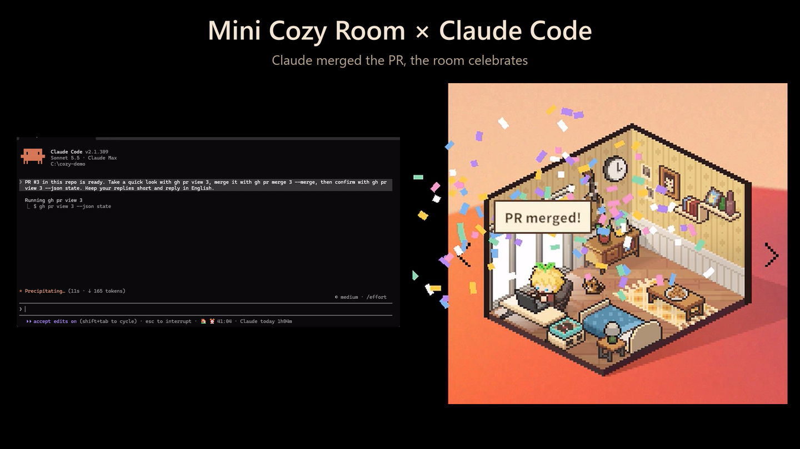
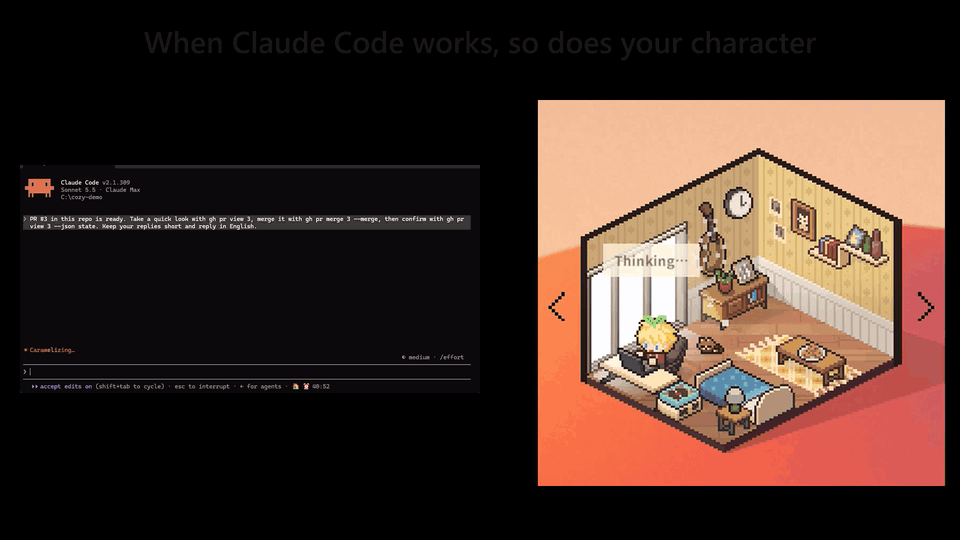

# Mini Cozy Room × Claude Code

[English](README.md) | **中文**

把 [Mini Cozy Room: Lo-Fi](https://store.steampowered.com/app/3511030/) 和 [Claude Code](https://claude.com/claude-code) 连起来的 mod：Claude 干活时，房间跟着它的状态变化；你开口时，Claude 也能动手布置房间。



## 功能

- **跟随 Claude 的状态**：Claude 干活时小人坐到桌前，停下时去休息；头上的气泡显示当前步骤，比如「思考中」「正在跑测试」「在改 README.md」。
- **确认提醒**：Claude 等你批准时，气泡给出提醒、宠物做反应；游戏最小化时任务栏按钮会闪。
- **任务清单**：Claude 的任务变成房间里的待办清单，做完一项勾一项。
- **房间信号**：每个 subagent 多带一只宠物，工具报错时切成雨声，Claude 干活时秒表计时。
- **Claude Code 里的状态**：输入框下面那行显示正在放的歌、计时和今天干了多久。
- **Claude 的房间工具**：让 Claude 加 memo 和待办、开番茄钟、换歌或换环境音。
- **不留痕迹**：会话结束后，房间回到原来的样子。



<sub>演示为 1.5 倍速，游戏设为英文 · [高清 MP4](docs/media/demo.mp4)</sub>

## 安装

**环境要求**：Windows 10/11、Steam 版游戏、Claude Code 2.1.299 以上、Git、.NET SDK 6 以上。

把 [INSTALL.zh-CN.md](INSTALL.zh-CN.md) 里的 prompt 复制到一个新的 Claude Code 会话里。Agent 会备份存档、安装 MelonLoader、编译部署 mod、安装插件、打开 Claude 的任务工具，每一步改动前都会先问你。手动安装、更新和卸载也在那一页。

## 使用

装好以后什么都不用做：打开游戏，开一个 Claude Code 会话，房间就会跟着动。

想让 Claude 布置房间，直接在对话里说：

> 「我要学习了，帮我调成适合专心的状态」·「放一首钢琴曲」·「开番茄钟」·「加个待办：复习第三章」

| 工具 | 做什么 |
| --- | --- |
| `room_note` | 加一条 memo 或待办清单，标题带 `[Claude]` 前缀 |
| `room_clear_claude_notes` | 只删 Claude 加的 memo 和清单 |
| `room_timer` | 番茄钟：开始、暂停、查看状态 |
| `room_music` | 列出你的歌；按名字播放、上一首、下一首、暂停、继续 |
| `room_ambience` | 列出环境音；设置、添加或停止 |

mod 的文字跟着游戏语言走：简体或繁体中文显示中文，其他语言显示英文。

## 工作原理

| 部分 | 目录 | 作用 |
| --- | --- | --- |
| 游戏 mod | [`game-mod/`](game-mod/) | MelonLoader mod `CozyClaude.dll`，在游戏里驱动房间 |
| Claude Code 插件 | [`claude-mod/`](claude-mod/) | 插件 `cozy-room`，上报 Claude 的状态并提供房间工具 |

两边只通过 `%LOCALAPPDATA%\CozyClaude\` 里的小文件通信，不开端口，不联网。

## 设计原则

- **不影响 Claude Code**：钩子先放行事件，自己的错误自己吞掉；房间工具 5 秒超时。
- **出问题看得见**：每个功能单独做健康检查，游戏更新后对不上的功能会自动停用，并在状态栏标出来。
- **不破坏存档**：mod 改过的东西会在会话结束或下次启动时复原，你自己的 memo、待办和统计数据都不碰。
- **不碰联机和付费内容**：联机房间里什么都不做，只用你已经拥有的内容。
- **不刷经验**：自动功能从不取消静音，游戏按「有声音的时长」给的经验不受影响。
- **只认本机**：只接受带有本机随机令牌签名的文件。

## 配置

游戏 mod 读取 `%LOCALAPPDATA%\CozyClaude\config.json`，第一次启动时自动生成。改完要重启游戏。

<details>
<summary>全部配置项</summary>

| 键 | 默认值 | 含义 |
| --- | --- | --- |
| `WorkActivities` | `[10003, 10002]` | Claude 干活时的动作：取房间里有对应家具的第一个（桌前笔记本、桌前画板） |
| `RestActivities` | `[10021, 10031, 10011, 10024]` | Claude 停下时的动作（床、沙发、懒人沙发、床上看书） |
| `TimerMode` | `"stopwatch"` | 跟着 Claude 走的计时器：`stopwatch`、`pomodoro` 或 `off` |
| `RestoreOnSessionEnd` | `true` | 会话结束时复原房间 |
| `RainOnError` | `true` | 工具报错时切成雨声 |
| `RainSoundKey` | `20005` | 用作雨声的环境音 |
| `RainUnmutes` | `false` | 环境音静音时为雨声取消静音 |
| `PetNudgeWhileWaiting` | `true` | 等待确认时宠物做反应 |
| `WaitingText` | `""` | 自定义等待气泡文字，留空用默认文字 |
| `MaxSubagentPets` | `3` | subagent 宠物最多几只 |
| `ShowActivity` | `true` | 气泡显示 Claude 当前的步骤 |
| `SyncTaskList` | `true` | 把 Claude 的任务同步成房间里的待办清单 |
| `AttentionWhenHidden` | `true` | 游戏隐藏时闪任务栏、更新托盘提示 |
| `AttentionSound` | `false` | 同时播放游戏的计时器提示音 |
| `AttentionRestoreWindow` | `false` | 同时把游戏窗口弹出来 |
| `Language` | `"auto"` | `auto` 跟着游戏；`zh` 或 `en` 固定语言 |

</details>

## 已知限制

- 在游戏 1.07.01（Unity 6000.3.22f1）和 Claude Code 2.1.299 上测过。游戏更新后 MelonLoader 可能加载不了（[MelonLoader#1159](https://github.com/LavaGang/MelonLoader/issues/1159)），这时状态栏显示「房间离线」，Claude Code 照常工作。
- MelonLoader 让游戏启动多花约 3 秒，隔很久第一次打开会更久。
- 只有中文和英文。房间工具回给 Claude 的文字是中文，Claude 会用你的语言转述。
- 游戏本身不保存番茄钟状态，重启后会重置。
- 联机保护只做过模拟测试。

## 路线图

- [ ] 按项目切换房间或装修预设
- [ ] commit、PR 合并、测试通过时放庆祝特效
- [ ] Claude 上下文快满时小人犯困
- [ ] 在 Claude Code 里提示番茄钟休息
- [ ] 每日小结 memo
- [ ] 任务成功时小人做表情
- [ ] 更多语言
- [ ] 在真实联机房间里验证联机保护

不在计划内：把 Claude 的状态分享给联机好友、按 Claude 的使用量给游戏奖励。

## 开发

```bash
dotnet build game-mod -c Release -p:DeployToGame=true
```

```bash
claude plugin test claude-mod
```

编译引用的是 MelonLoader 生成的程序集，所以要先装好 MelonLoader 并启动过一次游戏。改了 `claude-mod/` 后，把 `claude-mod/.claude-plugin/plugin.json` 的 `version` 加一。游戏内部 API、踩过的坑和测试记录在 [MODLOG.md](MODLOG.md)（英文）。

---

<sub>个人非官方 mod，与游戏开发商无关。只支持 Windows 和 Steam 版。</sub>
